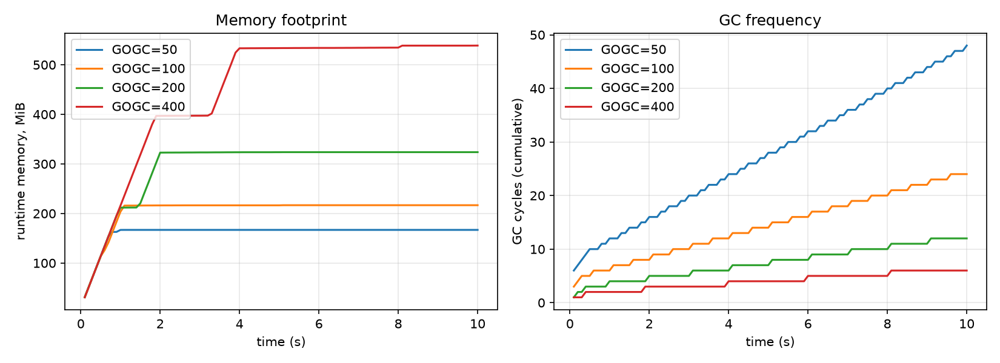

# Week 1 Progress - Background Research and Experimental Design

Reading list: [../readings/README.md](../readings/README.md). Reading log: [reading-log.md](reading-log.md).

## Done

- [x] Project repository set up: Go module, directory layout
- [x] `cmd/gcprobe`: allocation workload with configurable rate, object size, and lifetime; samples `runtime/metrics` to CSV
- [x] gcprobe smoke test (10/27, Go 1.27.3, Windows): `-rate 100 -lifetime 300ms -duration 2s` gave a live heap of about 31.5 MiB (expected 100 MiB/s x 0.3 s = 30 MiB), heap goal about 63 MiB (about 2x live heap, as GOGC=100 predicts), 9 GC cycles
- [x] `scripts/sweep_gogc.sh` and `scripts/plot_week1.py` for the GOGC sanity sweep
- [x] Draft research questions and experiment design (`docs/experiment-design.md`)
- [x] Reading list organized by topic, with local copies of the Go docs (`readings/`)
- [x] Background reading and notes, part 1: GC design, tuning knobs, pacer, Green Tea (`docs/background.md` sections 1-4)
- [x] Background reading and notes, part 2: prior work (section 6) and observability
  lessons from it (section 5; the `runtime/metrics` docs are still to read)
- [x] Sweep run (10/29, Go 1.27.3, Windows, GOMAXPROCS = 4), with the figure added below

## Sanity check result

Setup: rate = 200 MiB/s, lifetime = 500 ms, GOGC in {50, 100, 200, 400}, GOMAXPROCS = 4.

| GOGC | GC cycles (10 s) | Final runtime memory | GC CPU fraction |
|---|---|---|---|
| 50 | 48 | 166.9 MiB | 0.0023 |
| 100 | 24 | 216.7 MiB | 0.0012 |
| 200 | 12 | 323.7 MiB | 0.0011 |
| 400 | 6 | 538.8 MiB | 0.0005 |

The pipeline behaves as the cost model predicts. With a live heap of about 100 MiB,
each doubling of GOGC halves the number of cycles (48, 24, 12, 6), and memory grows
roughly as live heap x (1 + GOGC/100). At GOGC = 400, memory takes about 4 s to
reach steady state, so later comparisons should drop a warm-up period.

Known issue: GC CPU stays below 0.3% even with GOMAXPROCS fixed at 4. gcprobe
allocates pointer-free `[]byte` objects, so marking has almost nothing to scan, and
only one goroutine allocates, so most of the 4 Ps are idle. The week 2 workload
needs pointer-rich objects and concurrent request goroutines for GC CPU to show.

## Key takeaways from the reading

- **The trade-off is real but moves.** GOGC trades memory for GC CPU almost
  exactly as the GC guide's formula says, and the sweep confirms it. But Green Tea
  lowers the cost per byte of marking, so the gains Uber and Twitch reported on
  older Go versions are an upper bound, not an expectation.
- **Latency comes through assists.** Twitch's p99 gain came from fewer mark assists,
  not shorter pauses. This was the most useful point for me: it means throughput
  and GC CPU alone can miss the effect on users, and p99 has to be a first-class
  metric.
- **Existing tuners only watch memory.** Uber's GOGCTuner and the ballast both aim
  at a memory target. GOMEMLIMIT now does most of that natively. The room left for
  a controller is in signals they ignore: latency, allocation rate, phase changes.
- **Stay above the pacer.** The pacer already decides when each cycle starts;
  a controller should only change the target (GOGC or the limit), and should not
  fight the 50% GC CPU cap near the memory limit.
- **Methodology to borrow.** From Blackburn et al.: fix the memory budget as a
  multiple of the live heap and split time into mutator and GC. From Uber: act once
  per GC cycle instead of on a timer, and log time between cycles.

## Plan for week 2

- Turn gcprobe into a request-serving workload with per-request latency (p50/p99)
- Open-loop load generator with steady, bursty, and phase-change patterns
- Experiment runner that records metadata and repetitions
