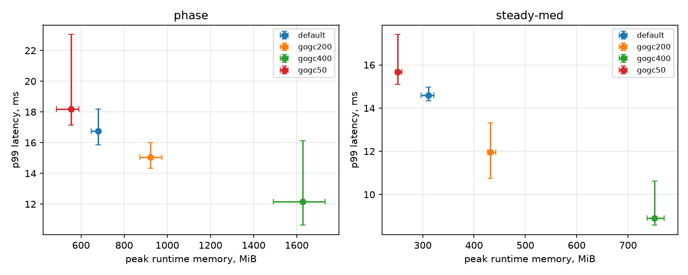

# Week 2 Progress - Workload Implementation

Design decisions and calibration details are in
[experiment-design.md](experiment-design.md) ("Workload" and "Calibration").

## Done

- [x] `cmd/gcserve`: in-process server with an open-loop Poisson load generator,
  pointer-rich request trees, and a long-lived cache that sets the live heap
- [x] Latency measured from the scheduled arrival time (no coordinated omission),
  split into service time and dispatch lag for diagnosis
- [x] Load patterns: steady, phase change (`-phases`), bursty (`-phases ... -loop`)
- [x] GC CPU metrics that work at partial load: GC share of non-idle CPU, assist
  share, and **GC demand** (GC CPU minus idle-priority marking)
- [x] Calibration on the dev machine: latency floor, saturation rate, live heap vs.
  cache size, GOGC sanity check
- [x] `scripts/run_matrix.py` (matrix x repetitions, shuffled order, shared seeds,
  run metadata) and `scripts/aggregate.py` (median + order-statistic CI, plot)
- [x] Pilot run: 2 workloads x 4 GOGC settings x 6 repetitions, 48/48 runs OK

## Pilot result

Setup: Windows 11, i9-14900HX, Go 1.27.3, GOMAXPROCS = 4, commit `5d7743f`.
20 s runs, first 5 s left out. `steady-med`: 30000 req/s, cache 128 MiB.
`phase`: 10 s at 10000 req/s with cache 64 MiB, then 15 s at 40000 req/s with
cache 256 MiB. Medians of 6 runs; brackets are the [min, max] interval, which
covers the median with 96.9% probability for n = 6. Raw data: `results/week2-pilot/`.

| Workload | GOGC | p99 (ms) | p99.9 (ms) | GC demand | Assist | CPU/req (us) | Peak mem (MiB) |
|---|---|---|---|---|---|---|---|
| steady-med | 50 | 15.7 [15.1, 17.4] | 23.2 | 0.50 | 0.11 | 31 | 251 |
| steady-med | 100 | 14.6 [14.3, 15.0] | 20.6 | 0.38 | 0.02 | 16 | 311 |
| steady-med | 200 | 12.0 [10.8, 13.3] | 18.2 | 0.30 | 0.01 | 9 | 432 |
| steady-med | 400 | 8.9 [8.6, 10.6] | 16.1 | 0.21 | 0.01 | 6 | 752 |
| phase | 50 | 18.2 [17.2, 23.0] | 50.4 | 0.57 | 0.27 | 41 | 555 |
| phase | 100 | 16.8 [15.9, 18.2] | 28.4 | 0.35 | 0.02 | 18 | 679 |
| phase | 200 | 15.0 [14.3, 16.0] | 25.7 | 0.29 | 0.01 | 12 | 922 |
| phase | 400 | 12.2 [10.6, 16.1] | 19.1 | 0.22 | 0.01 | 8 | 1628 |

(GC demand and assist are shares of the CPU the program pays for; CPU/req is
demand CPU per request. No requests were dropped in any run.)

What it shows:

- **The trade-off is clean and repeatable.** In steady state, each step up in GOGC
  lowers p99, GC demand, and CPU per request, and raises memory. Intervals mostly
  do not overlap, so 6 repetitions are enough to separate neighboring settings.
- **A phase change makes low GOGC much worse in the tail.** With GOGC = 50 under
  the phase change, assists rise to 27% of paid CPU (11% in steady state) and
  p99.9 doubles to 50 ms. While the cache grows, the live heap rises during each
  cycle and allocating goroutines are charged mark work, which is the Twitch
  mechanism showing up in our own data.
- **No fixed setting fits both phases.** The live heap goes from about 65 to
  330 MiB. GOGC = 400 gives the best p99 but peaks at 1.6 GiB, about 5x the live
  heap; GOGC = 50 keeps memory low but hurts the tail during the transition. This
  is the case an adaptive controller is meant for (RQ2).

Caveats:

- **Most of p99 is dispatch lag.** In steady-med at the default GOGC, p99 is
  14.6 ms, but dispatch lag p99 is 13.1 ms and service p99 is 3.8 ms. GC
  clearly drives the lag (it falls with higher GOGC), but the mechanism is not
  confirmed yet; see the open question in experiment-design.md.
- Requests are tiny (about 5 us of mutator work), so GC is a larger share of CPU
  than in a typical service.
- One Windows machine, single pilot; the timer floor is about 1 ms, so
  sub-millisecond differences (such as p50) are not meaningful.

## Plan for week 3 (baseline evaluation)

- Settle the two open design questions first: request work (`-work`) and the
  cause of dispatch lag during GC (`runtime/trace`)
- Decide the experiment machine (Windows dev machine vs. Linux) and stick to it
- Full baseline matrix: steady at low / medium / high load, bursty, and phase
  change; GOGC 50-400, plus GOMEMLIMIT at 1.5x and 1.2x of the measured peak
  live heap with GOGC = 100 and GOGC = off
- Pick the best fixed configuration per workload as the oracle baseline for week 5
- Add RSS and per-phase summaries to gcserve if the week 3 analysis needs them
