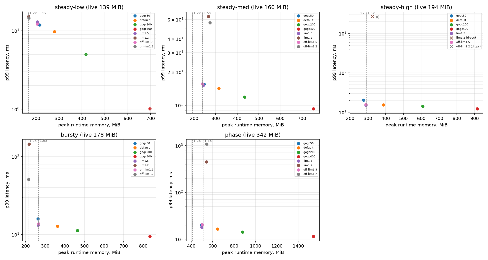
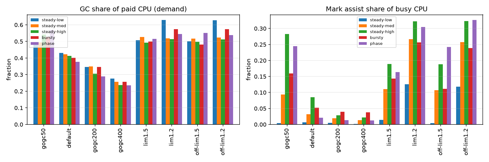
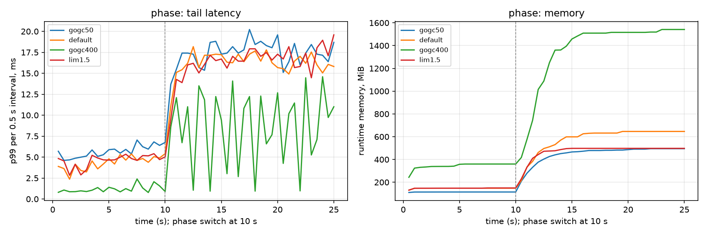

# Week 3 Progress - Baseline Evaluation

Setup and design decisions: [experiment-design.md](experiment-design.md). The
trace analysis of dispatch lag is in its section "Dispatch lag and the GC mark phase".

## Done

- [x] Decisions: stay on the Windows dev machine; keep `-work 1` (raising it to 8
  barely changes the GC share; noted as a limitation)
- [x] Dispatch lag explained with `runtime/trace`: the generator waits for a P
  while GC mark workers run (p99 wait 13.7 ms during marking vs. 0.25 ms outside)
- [x] `gcserve -trace`; per-workload memory budgets in `run_matrix.py`
  (`live_mib` x `memlimit_x`)
- [x] Peak live heap measured per workload (max of 3 runs at GOGC = 100)
- [x] Full baseline: 5 workloads x 8 configs x 6 reps = 240 runs, 240 OK
- [x] `scripts/analyze_baseline.py`: best fixed config per budget and RQ1 figures
- [ ] `runtime/metrics` package docs (reading list C) and background section 5 TODO

## Setup

Windows 11, i9-14900HX, Go 1.27.3, GOMAXPROCS = 4, commit `37be7ca`; 20 s runs,
first 5 s left out; medians of 6 runs. Raw data and figures: `results/week3-baseline/`.

| Workload | Load | Peak live heap (budget base) |
|---|---|---|
| steady-low | 10000 req/s, cache 128 MiB | 139 MiB |
| steady-med | 30000 req/s | 160 MiB |
| steady-high | 50000 req/s (~75% of saturation) | 194 MiB |
| bursty | 4 s at 10000, 1 s at 50000, repeated | 178 MiB |
| phase | 10 s at 10000 / cache 64, then 15 s at 40000 / cache 256 | 342 MiB |

Configs: GOGC 50 / 100 (default) / 200 / 400 without a limit; GOMEMLIMIT at 1.5x
and 1.2x of the peak live heap, with GOGC = 100 (`lim*`) or GOGC = off (`off-lim*`).
Note that GOMEMLIMIT caps total runtime memory, while the budget base is the live
heap, so 1.2x leaves very little room for anything else.

## Results

Median p99 (ms) / peak runtime memory (MiB):

| Config | steady-low | steady-med | steady-high | bursty | phase |
|---|---|---|---|---|---|
| gogc50 | 11.9 / 216 | 15.5 / 247 | 20.2 / 276 | 15.9 / 264 | 20.2 / 495 |
| default | 9.7 / 281 | 14.2 / 315 | 15.4 / 387 | 12.8 / 363 | 16.5 / 646 |
| gogc200 | 5.0 / 418 | 11.8 / 434 | 14.3 / 609 | 11.3 / 465 | 14.2 / 878 |
| gogc400 | 1.0 / 697 | 9.3 / 754 | 12.2 / 914 | 9.5 / 834 | 11.5 / 1541 |
| lim1.5 | 13.0 / 206 | 15.2 / 243 | 15.2 / 289 | 13.2 / 264 | 17.9 / 498 |
| off-lim1.5 | 12.2 / 206 | 15.6 / 239 | 15.8 / 289 | 13.7 / 266 | 20.4 / 503 |
| lim1.2 | 15.2 / 168 | 64.0 / 267 | 2703 / 325 (drops) | 145 / 218 | 447 / 543 |
| off-lim1.2 | 14.6 / 168 | 56.1 / 274 | 2621 / 352 (drops) | 51.2 / 216 | 1081 / 544 |

### Best fixed configuration (oracle baseline for week 5)

Rule: no dropped requests, median peak memory within the budget (+5% slack,
since the limit is soft), lowest median p99. From `best_fixed.csv`:

| Workload | No budget | 1.5x budget | 1.2x budget |
|---|---|---|---|
| steady-low | gogc400 (1.0 ms, 697 MiB) | gogc50 (11.9 ms, 216 MiB) | off-lim1.2 (14.6 ms, 168 MiB) |
| steady-med | gogc400 (9.3 ms, 754 MiB) | lim1.5 (15.2 ms, 243 MiB) | none fits |
| steady-high | gogc400 (12.2 ms, 914 MiB) | lim1.5 (15.2 ms, 289 MiB) | none fits |
| bursty | gogc400 (9.5 ms, 834 MiB) | lim1.5 (13.2 ms, 264 MiB) | off-lim1.2 (51.2 ms, 216 MiB) |
| phase | gogc400 (11.5 ms, 1541 MiB) | lim1.5 (17.9 ms, 498 MiB) | none fits |

"None fits": every 1.2x config overshot the budget by more than 5%.

## Findings (RQ1)

- **Without a budget, more memory always buys lower p99.** GOGC = 400 is best on
  every workload, at 4-5x the live heap. The gain is largest at low load
  (steady-low p99 9.7 -> 1.0 ms) and smallest near saturation (15.4 -> 12.2 ms),
  because at high load the remaining tail is mostly dispatch lag during marking.
- **At 1.5x, GOMEMLIMIT is the right tool.** Fixed GOGC cannot hit a budget
  across loads (gogc50 fits only steady-low), while `lim1.5` stays within budget
  everywhere, at a p99 close to the default's. GC = off vs. GOGC = 100 under the
  limit makes little difference here.
- **1.2x is the thrashing region, and it hits the 50% GC CPU cap.** At
  steady-high, GC takes 51% of busy CPU with almost no idle marking, i.e. the cap
  from proposal 48409. Memory overshoots the limit (321-370 vs. 233 MiB), the
  remaining CPU cannot serve 50000 req/s, the queue fills, and about 16-21k
  requests are dropped per run; p99 reaches 2.7 s. The cap protects against a
  true death spiral, but under open-loop load the service is still overloaded.
  At steady-med and in the phase workload the same effect gives p99 of 56 ms to
  1.1 s. Only steady-low survives 1.2x (p99 15 ms).
- **Assists are the latency mechanism under tight budgets.** Assist share is 1-9% at the default GOGC,
  up to 19% at 1.5x, and 12-33% at 1.2x; see the GC cost figure.

## What this means for the controller (RQ2)

Per-phase view of the phase workload (median of per-interval p99s, an
approximation; low phase = 2-10 s, high phase = after 15 s):

| Config | Low phase p99 / max mem | High phase p99 / max mem |
|---|---|---|
| default | 4.6 ms / 152 MiB | 16.4 ms / 760 MiB |
| gogc400 | 1.0 ms / 361 MiB | 10.8 ms / 1929 MiB |
| lim1.5 | 4.7 ms / 152 MiB | 17.2 ms / 512 MiB |
| off-lim1.5 | 0.9 ms / 493 MiB | 17.9 ms / 556 MiB |

`off-lim1.5` already adapts across phases: in the low phase it fills the budget
and gets GOGC-400-like latency, and in the high phase it behaves like `lim1.5`.
So inside a fixed memory budget, GOGC = off + GOMEMLIMIT is a strong adaptive
baseline, and the week 4 controller has to beat it, not just the default.
Where a controller still has room:

1. **Near the limit** (1.2x, high load): the runtime only reacts at the 50% CPU
   cap. A controller that sees rising assists or p99 could give up memory earlier
   (raise the limit within a hard ceiling) or warn, instead of letting the queue
   collapse.
2. **Latency-driven trade-off:** when there is spare memory, raise GOGC only as
   far as needed for a p99 target, instead of always filling the budget.
3. **Transitions:** react to a growing live heap before the limit is reached.

## Limitations

- One Windows machine; timer floor ~0.4-1 ms.
- Requests are tiny (`-work 1`), so GC is 25-60% of paid CPU, more than in typical services.
- Budgets are based on the peak live heap over the whole run; for the phase
  workload that is the high phase, so the low phase has a generous budget.

## Plan for week 4 (adaptive controller)

- Controller package driven by a per-GC-cycle hook (finalizer, as in Uber's
  GOGCTuner) plus `runtime/metrics`; it sets `debug.SetGCPercent` / `SetMemoryLimit`
- Inputs: live heap, heap goal, GC demand, assist share, and p99 from gcserve
- Policy v1: keep memory under the budget like `off-lim1.5`, but back off
  (raise the limit up to a hard ceiling, or lower GOGC) when assists or p99 rise
- Add it to gcserve as a config (`-controller`), compare first on phase and
  steady-high at 1.2x / 1.5x
- Read the `runtime/metrics` docs and close the background section 5 TODO
